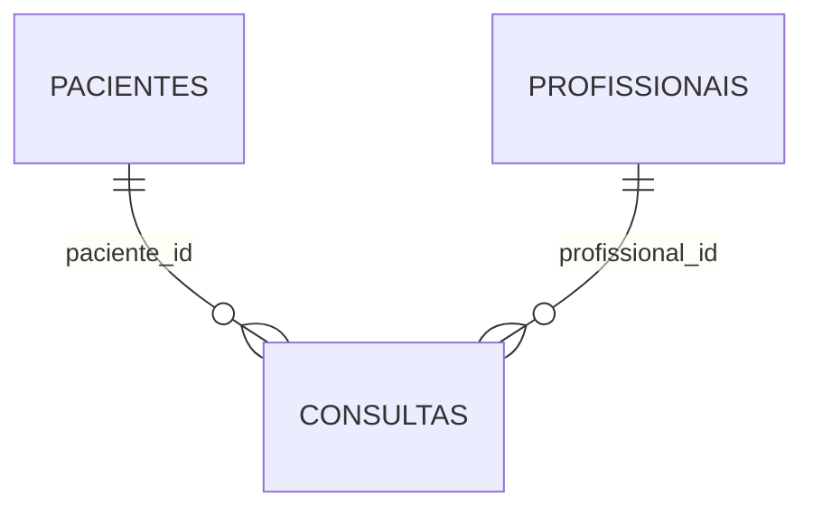

# Persistência segura — Exercício 11

SQLModel/SQLite substituiu a memória no CRUD, agenda e disponibilidade. SQLite em arquivo foi escolhido para a demonstração local; não exige servidor nem credencial de conexão.

## Configuração e schema

`BaseSettings` lê `DATABASE_URL` do ambiente/`.env`; `.env.example` contém `sqlite:///.local/consultas.db`. A versão aceita somente SQLite local. Excluir `.env`, banco e cadastro do Git/ZIP; proteger o arquivo por permissões do SO.

| Módulo | Responsabilidade |
| --- | --- |
| `app/settings.py` | Validação da URL; `SecretStr` evita exibição acidental |
| `database/session.py` | Engine por lifespan, FK por conexão, sessão por requisição e fechamento/rollback |
| `models/tabelas.py` | Tabelas internas, PK/FK/CHECK e UTC |
| `database/consultas.py` | Queries parametrizadas, CRUD e conflitos |
| `auth/policies.py` | Ownership com o recurso lido pela mesma sessão |

Startup cria tabelas/cadastros fictícios ausentes sem limpar consultas existentes. Vínculos de autorização continuam no servidor; FK não substitui ownership.



Consulta contém IDs, data/hora, motivo, status, notas e timestamps internos. FK impede referência inexistente; CHECK restringe três estados, motivo a 3–255 caracteres e notas a 500; campos obrigatórios são NOT NULL. Tabelas são separadas dos response models.

Horários são convertidos para UTC sem offset no SQLite; respostas retornam o mesmo instante em `America/Sao_Paulo`. Filtro diário usa limites do dia local convertidos em UTC, início inclusivo/fim exclusivo.

## Queries, sessão e concorrência

```python
query = select(ConsultaTabela).where(ConsultaTabela.paciente_id == paciente_id)
registros = session.exec(query).all()
```

O driver vincula valores; não há concatenação de entrada em SQL. PRAGMA/BEGIN são comandos constantes. O teste do driver confirma payload SQL como parâmetro; operadores em ID/filtro retornam 422.

`SessionDep` injeta sessão por requisição. Escritas abrem `BEGIN IMMEDIATE` antes de ownership/conflito; sucesso confirma, falha faz rollback e a sessão fecha. Intervalos de 30 min do mesmo profissional não podem sobrepor: cancelada libera, agendada/realizada bloqueiam; adjacência e outro profissional são permitidos. Criação, mudança de horário e reativação conflitantes retornam 409. O CRUD não proíbe expediente/fim de semana.

A reserva serializa escritores do mesmo arquivo; a segunda transação verifica o commit anterior. Disponibilidade consultada antes da escrita não oferece essa garantia. Escritores externos podem violar sobreposição: SQLite não tem constraint de exclusão. BUSY/LOCKED após 5 s retorna 503 e Retry-After, sem SQL/caminho; erro inesperado não vira 404/409. Sem retry automático de mutação.

## Migração e verificação

A memória anterior não tinha dados duráveis a importar. `create_all` cria tabelas, mas não migra schemas existentes. Alterações futuras exigem migração explícita e cópia antes de modificar banco existente; backup/restore operacional não foi ensaiado.

[Ex. 11](../evidencias/ex11/README.md): 181 testes, incluindo 18 de persistência, e 13 observações HTTP em dois processos. Verificam parâmetros, FK/CHECK, rollback, reinício, sessões, 503 e disputas concorrentes de criação/atualização com um sucesso e um 409. Mock de legado verifica escape sem desabilitar CHECK.

Scripts anteriores usam os respectivos baselines; snapshots do Ex. 8 continuam íntegros. O ANTES SQL isolado do Ex. 9 mantém ressalva acadêmica. Auditoria persistente, recuperação e operação clínica seguem no [relatório final](relatorio-capstone.md).

Referências: [SQLModel — sessão injetada](https://sqlmodel.tiangolo.com/tutorial/fastapi/session-with-dependency/), [SQLAlchemy — SQLite](https://docs.sqlalchemy.org/en/20/dialects/sqlite.html).
